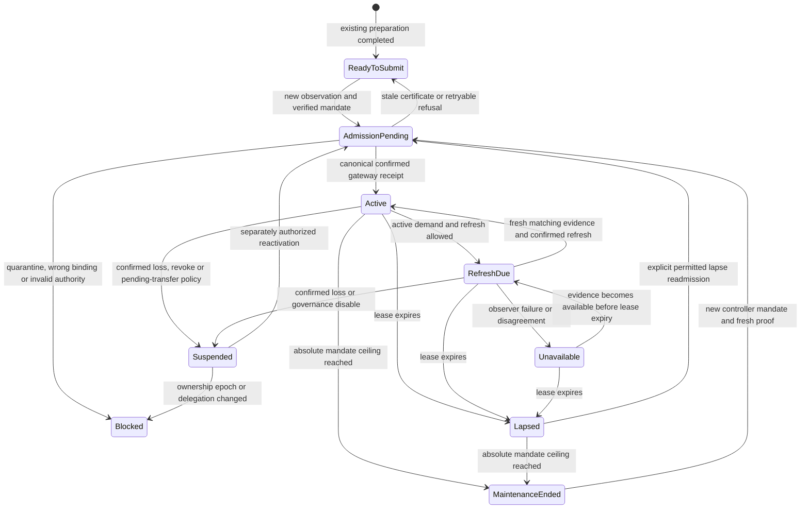

# HNS evidence to Registry V4: review proposal

This is a specification proposal responding to the joint cloud review. It is
not an accepted wire version, generated ABI, implemented gateway or permission
to submit transactions. The service still stops at ReadyToSubmit. Its qualified
executable source remains c59b601f; this proposal starts from HNS
[9b64b1f7](https://github.com/pirate-social-club/api-next/tree/9b64b1f7ee65807a67c4ee65f6d15482e5f12b38/standalone/hns-admission)
and Registry V4
[87e5f518](https://github.com/pirate-social-club/pirate-registry/tree/87e5f518730abfd6d987788503c214cbae0cf31f).
V3 source, its deployment and its consumer protocol remain separate.

The proposed join has two independent commitments. Namespace authorization
identifies durable HNS ownership and delegation. Observation evidence identifies
one fresh check of that authority. A new observation must not silently change
the community's authorization, cancel valid collected grants or extend their
deadlines. Changed ownership or delegation requires explicit reauthorization.

## Review dispositions and source map

| Review issue                        | Source today                                                                                    | Proposed disposition                                                                                                                                                 |
| ----------------------------------- | ----------------------------------------------------------------------------------------------- | -------------------------------------------------------------------------------------------------------------------------------------------------------------------- |
| Proof has no V4 hash mapping        | src/protocol.ts supplies setup binding/consent; V4 accepts arbitrary nonzero attestation hashes | Specify the commitments below and require the same vectors in TypeScript and Solidity before adoption.                                                               |
| No work after ReadyToSubmit         | src/automation.ts ends observation polling at readiness                                         | Keep preparation finite. Add a separate authority-lease lifecycle only after confirmed admission; every admission, reactivation and refresh needs a new observation. |
| Full admin needed for daily refresh | V4 attestNamespace, refreshNamespace, authorizeScope and refreshScope are onlyAdmin             | Put admin custody behind a real constrained gateway. Give the Worker separate bounded enrollment and refresh capabilities.                                           |
| Signer is per namespace             | V4 Policy.grantSigner; Binding.grantSigner is per installation                                  | One community/installation per TLD is the pilot limit. Supporting more also requires changing pd1, which currently selects one controller/community per chain.       |
| Signed wrapper does not exist       | Binding.wrapper is an address in the service signature domain                                   | Deploy and independently qualify a real gateway before selecting live bindings. An arbitrary address is not a wrapper implementation.                                |
| Origin occurs in signed context     | bindingDigest includes hostingOrigin and deploymentDigest                                       | Retain setup consent context, but use a new origin-free durable mandate for issuance authority. Never embed the old consent hash indirectly.                         |
| Enrollment is manually allowlisted  | src/access.ts and manifest select exact TLD/controller profiles, maximum 50                     | Label this staging-only. Public enrollment uses a generic target policy and verified controller/community binding, without per-TLD operator approval.                |

src/hsd-snapshot.ts owns REGISTER/FINALIZE ownership epochs and retained resource
inclusion. src/observation.ts and src/hsd-observer.ts own freshness, maturity and
agreement. src/records.ts owns pd1 and pc1 decoding and conflict rules.
src/ceremony.ts and src/aggregate.ts own ceremony progress, revisions and
reservations. None of those paths currently supplies V4 authority.

The Registry's source specification is
[shared-name-scope-v4.md](https://github.com/pirate-social-club/pirate-registry/blob/87e5f518730abfd6d987788503c214cbae0cf31f/docs/shared-name-scope-v4.md).
The proposal below does not reinterpret its revisions or relax its expiry rules.

## Exact commitment proposal

[encoding-vectors.json](review-evidence/v4-integration-proposal/encoding-vectors.json)
contains ordered field/type definitions, complete static ABI preimages,
EIP-712 domains, synthetic inputs, expected digests and nine mutation cases.
Those ordered definitions are the exact proposal encoding; names, widths,
ordering and domains are significant. All numbers in its policy are fixture
values, not selected live policy. No valid signature or HNS proof is asserted.

For a static struct T, compute its type hash as keccak256 of the UTF-8 string
`T(type field,type field,...)`, then compute
`keccak256(abi.encode(typeHash, field1, field2, ...))`. Do not use packed ABI,
JSON hashing or SHA-256 in place of that outer keccak256. EIP-712 messages use
the standard typed-data digest including their explicit domain.

| Registry field or intermediate  | Exact source and commitment                                                                                                                                                                                                                        |
| ------------------------------- | -------------------------------------------------------------------------------------------------------------------------------------------------------------------------------------------------------------------------------------------------- |
| namespaceId                     | Existing namespaceId(tld): keccak256 ABI encoding of keccak256("pirate.namespace/1") and keccak256 of the already validated canonical TLD.                                                                                                         |
| delegationHash                  | HnsDelegationV1 of decoded pd1: chainId, registry, controller, communityId. It commits to persistent delegation, not pc1.                                                                                                                          |
| Authority.authorizationHash     | HnsNamespaceAuthorizationV1: keccak256(network), actual HNS genesis, namespaceId, EVM chainId, registry, ownershipEpoch, delegationHash.                                                                                                           |
| policyDigest                    | EnrollmentPolicyV1: chainId, registry, gateway, submitter, paymentToken, namespaceClaimLimit, scopeClaimLimit, annualRenewalPrice, maxLeaseSeconds, maxMaintenanceSeconds, minimumRefreshIntervalSeconds.                                          |
| mandateDigest                   | EIP-712 NamespaceDelegationMandate with the ordered fields in the vector file. Domain name PirateNamespaceDelegation, version proposal-1, actual chainId, verifyingContract gateway. This is a new proposal domain, not CeremonyConsent version 1. |
| ScopeAuthorization.evidenceHash | CommunityMandateEvidenceV1 of mandateDigest and SHA-256 of the exact retained controller-signature bytes. Retain the original validated signature artifact; do not re-sign or replace it during refresh.                                           |
| scopeAuthorizationHash          | Existing V4 EIP-712 ScopeAuthorization, domain PirateSharedNames/version 4, actual chainId and registry. Its namespaceAuthorizationRevision is the chain's semantic Authority.revision.                                                            |
| Authority.evidenceHash          | HnsObservationEvidenceV1 of the stable namespace authorization and the observation fields defined in the vector file. This changes on each qualifying fresh observation.                                                                           |

The mandate signs namespaceId, namespaceAuthorizationHash, communityId,
installationId, controller, grantSigner, installationKey, registry,
sourceProfileDigest, policyDigest, maintenanceUntil, nonce, issuedAt and
deadline, in that order. It authorizes only the named installation and fixed
policy until a finite absolute maintenance ceiling. Its signature deadline is
the deadline for initially accepting it; successful acceptance stores its nonce
and mandate identity. It is not permission to refresh without checking HNS.

The sourceProfileDigest is the selected, origin-free RegistrySource descriptor
digest, not a Git commit, ABI hash or deployment's complete context digest.
The existing service uses a 0x-prefixed bytes32; a consumer using bare hex must
perform an explicit validated representation conversion. It must not substitute
a similarly named digest with a different meaning.

ownershipEpoch is the existing snapshot reader's SHA-256 of the exact UTF-8
colon-joined string `pirate.hns-owner-epoch/1:genesis:txhash:index`, with the
lowercase unprefixed genesis/transaction hashes and decimal output index of the
last REGISTER or FINALIZE. UPDATE, RENEW and transfer cancellation preserve that
epoch. A finalized transfer changes it even if the destination address is the
same. An expired name or pending transfer cannot receive a fresh attestation.

Observation resource digests retain the current codec's SHA-256 meaning.
observerPolicyDigest and proofArtifactDigest are SHA-256 of exact retained,
versioned artifact bytes, with their byte encoding and media type stored in the
artifact record. A hash supplied by the Wizard is insufficient: the verifier
must construct and validate those artifacts from its own chain observations.
The rolling evidence includes tip/safe-root/inclusion anchors, resource digests,
observer policy and observedAt. A gateway event must also retain the mandate
and independently verified community/installation evidence digest. That second
digest is not replaced by an HNS observation or a hosting-origin check.

Current/safe ownership, routing and mature persistent delegation must agree.
Initial admission additionally verifies pc1 against the original ceremony.
After admission pc1 may be removed; refresh checks pd1 and the stored ownership
epoch without requiring the old complete resource digest or challenge forever.
NS/DS changes therefore change observation evidence, not namespace authority.

The stable commitments exclude hostingOrigin, setup bindingDigest,
CeremonyConsent, deploymentDigest, request signatures, service revision,
observation time/blocks and the temporary challenge. Including CeremonyConsent
would bring the origin back indirectly. HTTPS-origin changes follow the separate
Directory/controller installation-authorization path. They do not require HNS
republishing or change namespace authority. That path is not implemented here.

The base vector produces namespace authorization
`0x4c1f168b60fc52cb1e5106fe347fa39ffd13b616fdaa99f1b0afc36b92f14b8b`
and scope authorization
`0x47f2117d62776c10ead0757c89873c552aa012f9b40ec5f75784731e40af63bf`.
Origin/deployment changes preserve both; a fresh observation preserves both;
ownership-epoch changes alter both. Signer, policy and gateway changes alter the
scope commitment while preserving the HNS authority commitment. These are draft
encoding results only. Solidity agreement remains UNRUN.

## Admin custody and gateway capabilities

The recommended direction is a real NamespaceAttestationGateway that owns V4's
admin role. Governance is a multisig controlling the gateway, not a Worker
secret. The gateway exposes named operations and fixed registry calls; it has
no hot-key arbitrary call, delegatecall, target selection or admin-transfer
escape hatch. Governance retains the explicitly restricted policy, treasury,
migration and emergency operations. Their exact reviewed ABI and deployment
remain contract-owner work; no wrapper is delivered by this document.

| Capability             | Allowed operations                                                                                                       | Forbidden operations                                                                                                            |
| ---------------------- | ------------------------------------------------------------------------------------------------------------------------ | ------------------------------------------------------------------------------------------------------------------------------- |
| Enrollment authority   | admit a new verified binding; explicitly readmit a pure lapse under a still-valid stored mandate and a fresh observation | treasury/admin changes, arbitrary policies, raising stored caps, clearing governance quarantine/revocation or migration closure |
| Refresh authority      | refresh the exact enabled and unexpired namespace plus scope; suspend on confirmed authority loss                        | activate, revive a lapse, rebind, rotate signers, increase caps, extend the absolute maintenance ceiling or clear any disable   |
| Controller             | sign the durable mandate; request bounded installation-signer rotation or submitter switch for its own binding           | attest its own HNS facts or affect another namespace                                                                            |
| Transaction submitter  | relay only already-authorized gateway operations with independent nonce/budget management                                | create certificates, grants or authority by paying gas                                                                          |
| Community grant signer | decide member eligibility and sign grants on the community VPS                                                           | attest HNS or submit its own claims as the scope submitter                                                                      |
| Governance/guardian    | pause, quarantine, rotate service roles and approve exceptional corrections under the multisig policy                    | silently overwrite holder ownership or claim receipts                                                                           |

Guardian means the governance multisig for this pilot. A convenience alert to
workspace_owner grants no additional recovery authority. Multisig membership
and threshold must be recorded before deployment; the current proposal does
not assume that one email recipient can perform multisig recovery.

The proposed gateway operations are admit, refresh, suspend, readmitLapsed,
rotateInstallationSigner and changeSubmitter, plus governance-only controls.
admit/readmitLapsed validate a controller mandate, an enrollment certificate,
fresh HNS observation, community verification, fixed policy and exact expected
state. refresh validates a refresh certificate against the stored mandate and
binding. Certificates bind action, operation ID, mandate digest, observation
digest, community-evidence digest, policy digest, expected namespace semantic
revision/freshness version, expected scope/policy revision, observedAt and
validUntil. Their EIP-712 domain must name the actual chain and gateway.
Certificate typed-data bytes and gateway ABI require a separate jointly
reviewed specification and vectors before any signing is implemented.

Each operation performs compare-and-swap on all relevant state. In particular,
V4 attestNamespace lacks CAS arguments: the gateway must check state before
calling it atomically. Exact replay returns the retained operation result;
different bytes under the same operation ID or mandate nonce are refused.
First admission may register an unknown namespace and configure only the fixed
enrollment policy, then attest and authorize its one scope atomically. Existing
namespace state, lifetime claim counts, migration closure and holder-preserving
cutover requirements cannot be bypassed as a new registration.

Limits belong on-chain: at most a 24-hour freshness lease, a finite stored
maintenanceUntil bounded by controller and governance ceilings, successful
refresh no more often than every 23 hours, fixed namespace/scope lifetime claim
caps and a bounded pilot capacity. A Worker certificate older than 120 seconds
must be re-observed before submission. Those are proposed gateway limits, not
behavior V4 already enforces. The maximum maintenance duration, monetary
sponsorship ceilings and enrollment-capacity policy remain explicit policy
inputs; the fixture's seven-day duration and numeric caps select none of them.

A refresh request must authenticate the bound controller or installation key,
or arise from stored authorized maintenance demand. An arbitrary public caller
cannot cause sponsored transactions. Coalesce requests per binding, simulate
the exact call before broadcast and enforce sponsorship budgets before nonce
allocation. On-chain refresh spacing bounds successful extensions; it does not
by itself prevent a compromised sender from spending gas on reverted calls.

Separation of grant signer, attester roles and active submitters must be checked
both initially and on every rotation. Controller-signed, rate-limited signer
rotation and a switch to the controller's own gas-paying submitter should be
named restricted operations, not multisig rebinds or refresh side effects.
They invalidate old grants using the appropriate policy/scope revisions and
require no HNS republish when controller/community delegation is unchanged.
V4 does not implement those controller-authorized operations today.

Endpoint certificates remain trusted statements about HNS. The gateway cannot
check whether their chain observations are true. Restricted roles, caps and a
finite ceiling limit a compromise; they do not convert an oracle attestation
into a cryptographic HNS proof.

Worker deployment access, Cloudflare account membership, CI deployment tokens
and Infisical access are inside the signing-key boundary. Separate enrollment,
refresh and sender credentials limit capability, but secrets exposed to the
same deploy authority are not independent trust domains. Exact secret custody,
rotation and pause procedures must be reviewed before keys are provisioned.
Alchemy owns deployment/resources and durable coordination; Effect owns service
logic. This proposal introduces no Wizard dependency upgrade or signing secret.

## Refresh cost and life after admission

With current V4, every active namespace and every active community scope needs
refresh before its one-day expiry. For the single-community pilot a gateway can
batch both calls into one sponsored transaction, roughly one per active TLD per
day, plus admissions and exceptional changes. It remains two registry state
updates. Claim relay/gas budgets are a separate sponsorship packet. Sponsorship
eligibility means a valid community grant within budgets and protocol limits;
Pirate does not decide community membership again.

A missed namespace lease cannot be revived by refreshNamespace. Explicit
attestNamespace increments the semantic revision; all scopes must then be
explicitly readmitted. The proposed readmitLapsed gateway operation can automate
that only for the exact stored binding with a valid mandate, no governance
disable, fresh matching HNS/community evidence and unchanged caps. It cannot
reuse old grants across that revision change. This is unimplemented.

Decoupling a longer community authorization from the daily HNS lease requires a
contract change: current V4 caps scopes at one day and namespace validUntil.
A pure freshness lapse and a semantic revoke must have distinct recovery
semantics. A scheduler or wrapper alone cannot create that distinction inside
V4. The contract owner should decide that change before a refresh executor is
built. It must retain the independent namespace freshness gate on every claim.

This is the proposed post-preparation lifecycle, not additional current ceremony
phases. It runs in the same independently owned Alchemy/Effect service after a
real admission receipt. Observation wakes use stored deadlines, may be late and
reschedule prolonged outages explicitly. No wake extends a lease by itself.
Unknown submitted transactions retain their identity and reservation until
canonical reconciliation; a timeout never means an unsubmitted operation.

Unavailable evidence prevents a new attestation or extension. It is not a
negative ownership result. Current code requires both configured observers;
one being unreachable is unavailable, and observer disagreement always blocks.
A one-healthy-node fallback remains an unresolved policy, not an enabled
feature. No live observers are configured by this proposal.

Revalidation can be on demand; no continuous ownership watcher is claimed.
Under that model a later transfer, expiry or removed delegation is discovered
on the next check, with the accepted 24-hour lease as the upper stale window.
Refuse new attestations during pending transfer. Do not require a minimum
remaining HNS renewal horizon. On confirmed loss stop new authorization and
suspend using current revisions; do not erase NFTs, receipts or holder record,
transfer and renewal rights. A TLD owner can still change external resolution.

Same-controller installation rebuilds use bounded signer rotation. Controller
wallet loss, sale to a new HNS owner, wrong admission, governance quarantine and
re-enabling are explicit new-authority or governance flows. A finalized HNS
transfer invalidates the old ownership epoch even if pd1 was left in place.
Routine freshness refresh cannot conceal those changes or undo a disable.

## Automatic enrollment and verification order

Public create authenticates the controller signature against a server-owned
target policy: HNS network/genesis, EVM chain, registry, real gateway, source
profile and enrollment limits. It creates a proposed ceremony; it does not
reserve on-chain authority or permanently claim the TLD for that controller.
Rate limits and the pilot capacity are service policy, not a manual allowlist
approval. Invalid or abandoned requests must not squat on a namespace.

Before admission the service independently verifies current mature HNS evidence,
selected pd1 controller/community, original freshness challenge, durable mandate
signature, canonical community/installation mapping and its separate controller
authorization, target/source pins and current registry revisions. Only then may
the bounded enrollment role authorize gateway submission. A public API body,
ordinary HTTPS setup or an unverified Directory registration is insufficient.
The Directory/installation producer and its exact authorization contract remain
an explicit integration dependency; HNS ownership does not prove them.

The operator-facing pilot documentation must say one community/installation per
TLD, explain manual record publication and retained NS/DS, and allow resuming
later. Existing publication deadline 48 hours, maturity window 24 hours after
timely inclusion and consent lifetime 72 hours remain distinct. No challenge
publication should happen until the actual registry/community/gateway and
encoding are frozen. A subsequent pc1 cleanup is optional after admission.

## Finite build order and acceptance

First review these commitments with the contract owner and select constrained
admin custody plus the scope-lifetime/lapse behavior. Require contract size,
compiler/generated ABI qualification and cross-language vectors on the exact
successor. Do not publish an HNS record against an invented or changing target.

Next review the sponsorship packet, certificate bytes, limits and key custody.
That packet owns transaction coordination, shared sender nonce queues, bounded
retries, one approved fee bump/standby strategy, simulated calls, monetary
ceilings and crash reconciliation. A stale/pause/rate-limit refusal must return
to a retryable stage with re-observation; it must not discard a completed HNS
ceremony. No speculative submission or recovery implementation belongs here.

Then replace the staging allowlist and connect the canonical community producer,
origin-free mandate and gateway adapter. Add post-admission lease handling only
against the accepted contract. Resolver pd1 enforcement and the Wizard
namespaceProofCollector remain distinct consumer work. ReadyToSubmit alone
never satisfies NamespaceControlPort.

Meaningful acceptance includes altered owner/delegation/community/installation
and target substitutions; cross-chain/domain replay; signer/submitter overlap
after rotation; stale certificate and changed CAS state; wrong resource size;
pending transfer and reorg; unavailable/disagreeing observers across expiry;
pure lapse versus revoke; unchanged grants across freshness-only refresh;
old grants rejected after semantic change; origin changes preserving authority;
one nonce queue across concurrent namespaces; crash between broadcast and
acknowledgement; and sponsorship exhaustion preserving holder rights.

This packet locally computes draft encodings and mutation invariants only.
Solidity cross-check, gateway implementation, submission, deployment, live
observation and end-to-end admission remain UNRUN. Existing package results are
in [the review entry point](REVIEW.md); they do not qualify this new protocol.
The operator manual-publication path can use the existing test wallet/TLDs with
NS/DS records once values are frozen. Any later external-operator acceptance
must be described honestly as separate evidence rather than inferred from an
internal wallet run. Linux failed-install reconciliation remains outside this
protocol and this proposal.
